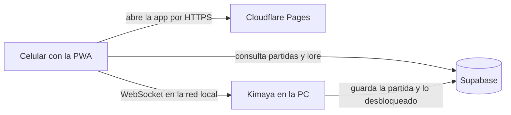
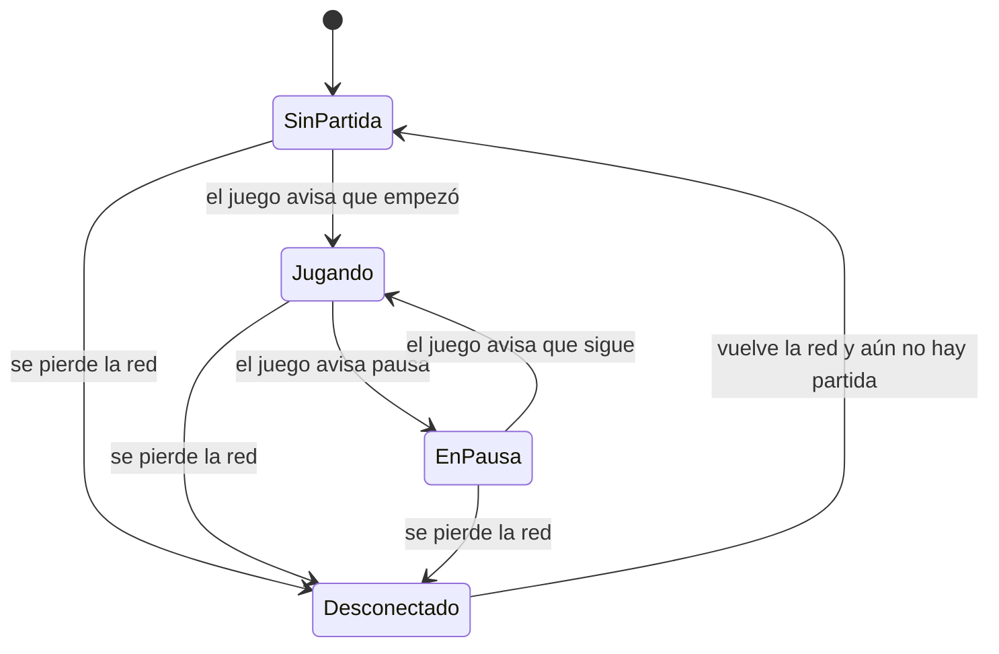
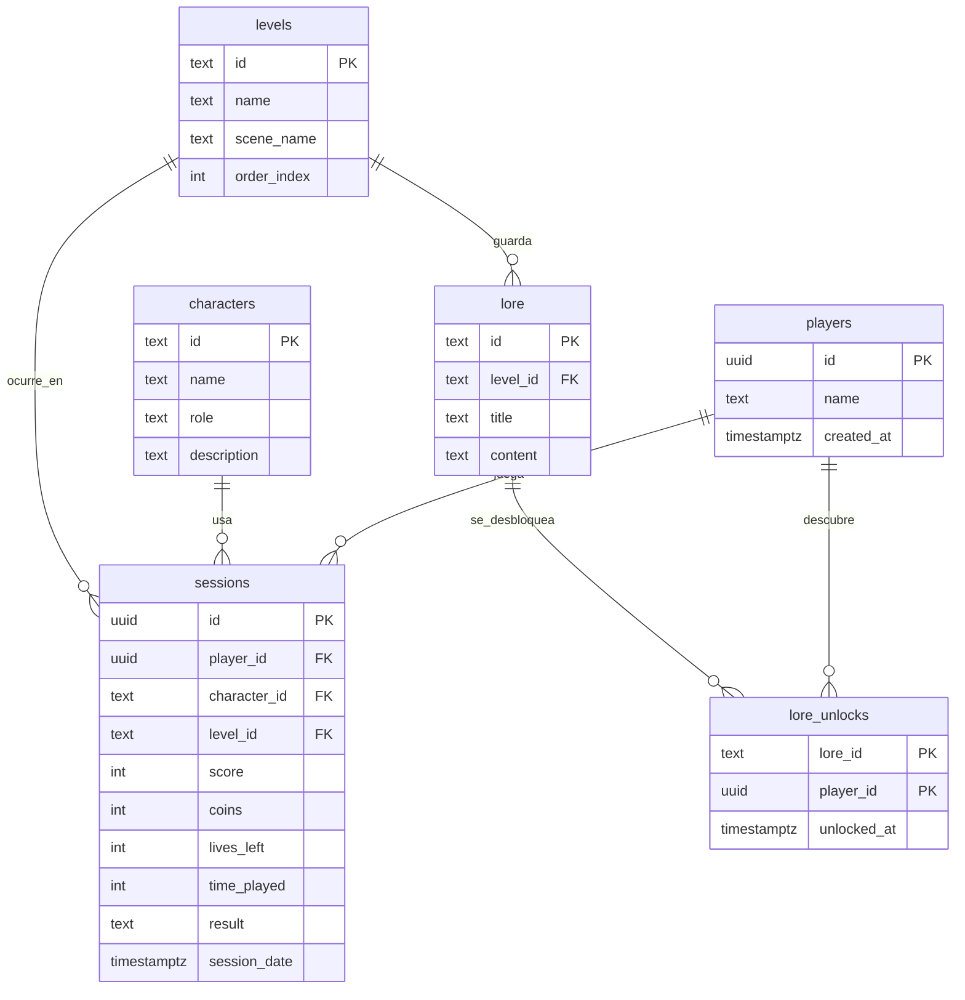
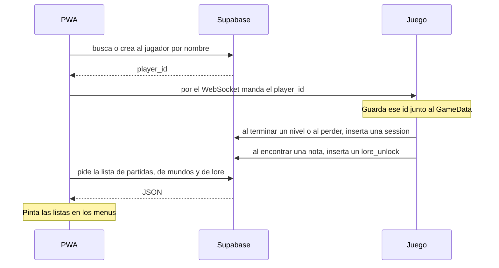
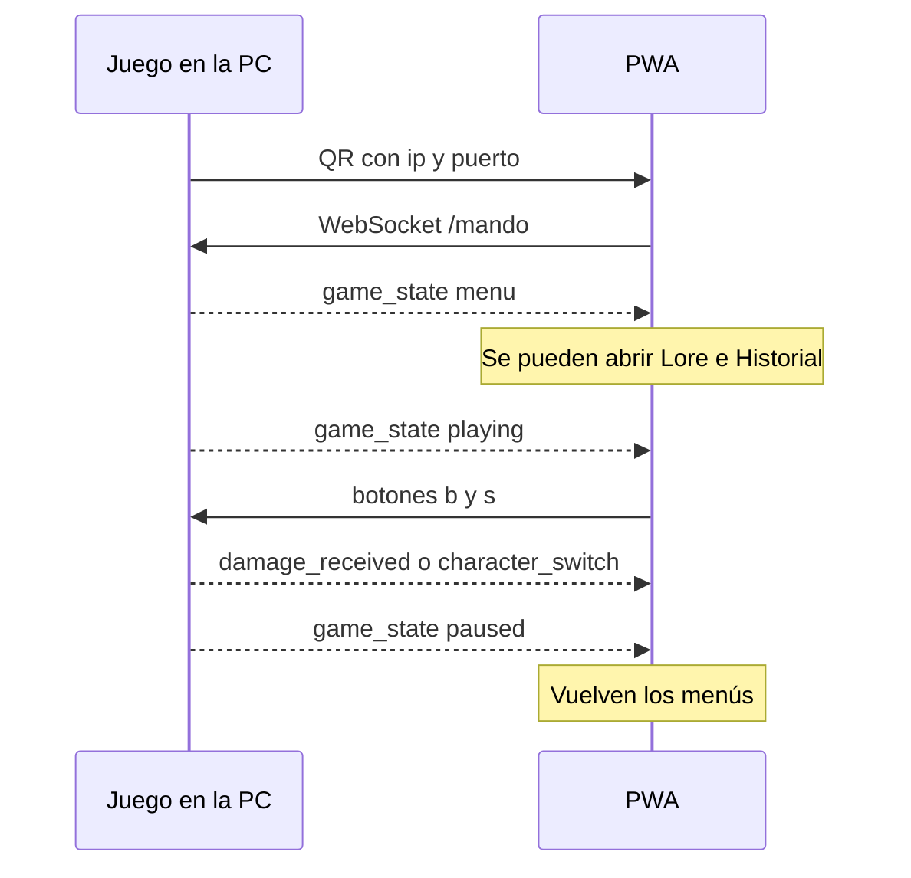
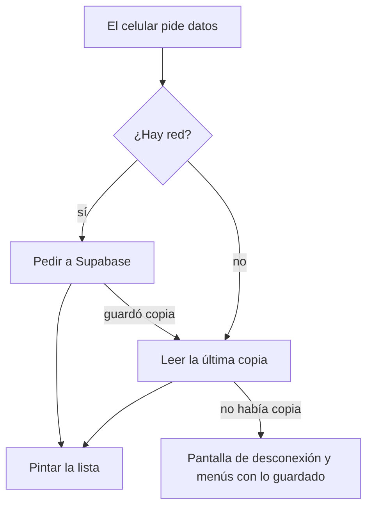
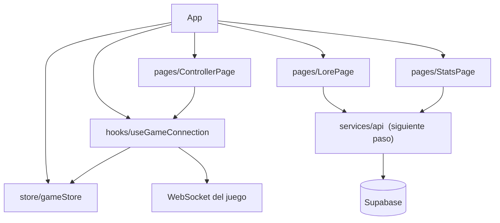

# Kimaya Companion — propuesta de PWA

Companion app para el juego de plataformas **Kimaya: El Bosque del Eco**. El celular se usa como mando y, cuando la partida está en pausa o todavía no empieza, también como bitácora: lore del bosque e historial de partidas.

El juego de PC vive en otro repositorio y no se modifica desde aquí. Este repo es solo la aplicación web.

## Por qué así

La rúbrica pide tres cosas: consumir una API y pintar listas, funcionar como PWA (service worker, manifest, offline) y una interfaz modular, hecha para celular.

Por eso la app no guarda las partidas dentro del teléfono como única fuente. El juego, al cerrar un nivel, escribe el resultado en Supabase. La PWA lee esa misma base. Así el historial y el lore se pueden ver aunque la computadora esté apagada.

El mando es otro canal. Los botones no pueden irse a la nube porque se sentirían tarde. Van por WebSocket, en la red local, directo a la PC donde está abierto el juego.

## Topología



El QR lo muestra el juego en la PC. Al escanearlo, el celular abre la PWA con la IP y el puerto de esa computadora:

`https://<dominio-de-la-pwa>/?ip=192.168.1.20&port=8080`

La persona escribe su nombre en la app. Con ese nombre se busca su fila en Supabase y, si no existe, se crea. A partir de ahí el historial y el lore son de esa persona.

## Qué ve el jugador

La ventana va siempre en horizontal, como un control.

- Si el juego **no ha empezado** o está **en pausa**, arriba hay dos menús desplegables: Lore e Historial.
- Si la partida **está corriendo**, esos menús se guardan y se queda el mando.
- **Falin** usa tema amarillo. Además de la cruceta y los botones de acción, tiene Empujar y Salto impulsado.
- **Mia** usa tema rosa. Sus botones extra son Olfato y Espacio estrecho.
- Si el personaje recibe daño, la pantalla destella. Si la vida queda baja, se nota en la interfaz. Si vence a un enemigo, también hay un aviso corto.
- Para la presentación, sin tener el juego conectado, hay botones de demo que disparan esos mismos avisos y el cambio de personaje.



En SinPartida y en EnPausa se pueden abrir Lore e Historial. En Jugando solo el mando. En Desconectado aparece la pantalla de sin conexión, pero los menús siguen disponibles con lo último que se guardó en caché, y desde ahí se puede volver a escribir la IP o escanear el QR del juego.

## Base de datos

La base vive en Supabase (PostgreSQL). El juego y la PWA usan la misma API REST. No hay un servidor propio en medio.

Lo que hoy el juego guarda solo en memoria (`GameData`: personaje, nivel, puntaje, monedas y vidas) es lo que va a quedar escrito aquí cuando termine un nivel o se acabe la partida. Los mundos coinciden con las escenas que ya tiene el juego: la aldea y tres niveles.



| Tabla | Quién la llena | Qué representa en el juego |
| --- | --- | --- |
| `players` | La PWA, cuando la persona escribe su nombre | El jugador de esa partida |
| `characters` | Datos fijos. Falin y Mia | El personaje elegido en el menú |
| `levels` | Datos fijos. Aldea y tres niveles | `Village_Scene`, `Level_01`, `Level_02`, `Level_03` |
| `sessions` | El juego, al completar un nivel o al perder | Puntaje, monedas, vidas, tiempo y nivel donde quedó |
| `lore` | Datos fijos. Los textos del bosque | Notas que se pueden encontrar en un nivel |
| `lore_unlocks` | El juego, al encontrar una nota | Qué textos ya leyó esa persona |

`characters` y `levels` no cambian durante la partida. Existen para que la app pueda pintar listas (personajes y mundos) sin hardcodearlas. `sessions` y `lore_unlocks` sí crecen cada vez que se juega.

```sql
create table players (
  id uuid primary key default gen_random_uuid(),
  name text not null unique,
  created_at timestamptz not null default now()
);

create table characters (
  id text primary key,
  name text not null,
  role text not null,
  description text not null
);

create table levels (
  id text primary key,
  name text not null,
  scene_name text not null,
  order_index int not null,
  description text not null default ''
);

create table sessions (
  id uuid primary key default gen_random_uuid(),
  player_id uuid not null references players(id),
  character_id text not null references characters(id),
  level_id text not null references levels(id),
  score int not null default 0,
  coins int not null default 0,
  lives_left int not null default 0,
  time_played int not null default 0,
  result text not null check (result in ('nivel_completado', 'game_over')),
  session_date timestamptz not null default now()
);

create table lore (
  id text primary key,
  level_id text references levels(id),
  title text not null,
  content text not null
);

create table lore_unlocks (
  lore_id text not null references lore(id),
  player_id uuid not null references players(id),
  unlocked_at timestamptz not null default now(),
  primary key (lore_id, player_id)
);
```

Datos fijos con los que arranca la base:

```sql
insert into characters (id, name, role, description) values
  ('falin', 'Falin', 'fisico', 'Empuja objetos y usa un salto impulsado.'),
  ('mia', 'Mia', 'tactico', 'Entra en espacios estrechos y revela secretos con el olfato.');

insert into levels (id, name, scene_name, order_index, description) values
  ('village', 'Aldea', 'Village_Scene', 0, 'Donde empieza el recorrido.'),
  ('level_01', 'Nivel 1', 'Level_01', 1, 'Primera zona del bosque.'),
  ('level_02', 'Nivel 2', 'Level_02', 2, 'El bosque se cierra.'),
  ('level_03', 'Nivel 3', 'Level_03', 3, 'El ultimo tramo.');

insert into lore (id, level_id, title, content) values
  ('doc_01', 'level_01', 'El Despertar del Bosque', 'Mucho antes de que el mal corrompiera estas tierras, el eco del bosque guiaba a los perdidos.'),
  ('doc_02', 'level_02', 'Nota del Explorador Perdido', 'Si alguien encuentra esto, sigan el camino de las piedras amarillas.');
```

Para la demo de la escuela, la lectura con la llave pública (`anon`) queda permitida. La llave de servicio no se pone en el celular. Cada petición lleva estas cabeceras:

```
apikey: <anon key>
Authorization: Bearer <anon key>
Content-Type: application/json
```

## Cómo se usa esa base



La PWA no espera a que el juego esté encendido para leer. Por eso el historial y el lore se consultan por HTTPS a Supabase. El juego solo escribe cuando pasa algo dentro de la partida.

| Momento | Quién | Qué hace | Tabla |
| --- | --- | --- | --- |
| La persona escribe su nombre en el celular | PWA | Busca por nombre. Si no existe, lo crea | `players` |
| Se conecta el mando | PWA | Manda `{ "event": "identify", "player_id": "..." }` por el WebSocket | ninguna |
| Se completa un nivel (`LevelCompleteUI`) | Juego | Inserta la partida con `result = nivel_completado` | `sessions` |
| Se pierden las vidas (`GameOverUI`) | Juego | Inserta la partida con `result = game_over` | `sessions` |
| Se encuentra una nota | Juego | Inserta el desbloqueo. Si ya existía, no duplica | `lore_unlocks` |
| Se abre Historial, en pausa o antes de jugar | PWA | Pide las partidas de esa persona y arma la lista | `sessions` |
| Se abre Lore | PWA | Pide los textos ya desbloqueados y arma la lista | `lore_unlocks` + `lore` |
| Se quiere ver el recorrido | PWA | Pide los mundos ordenados y arma la lista | `levels` |

Una fila de `sessions` sale de lo que el juego ya tiene en memoria en ese instante: `score`, `coins`, `lives`, el nivel actual y el personaje elegido. `time_played` son los segundos desde que empezó esa partida hasta el momento de guardar. El detalle de cómo lo manda Unity está en `README_UNITY_DEV.md`.

### Endpoints que consume la PWA

La base de la URL es `https://<proyecto>.supabase.co`. Todas las respuestas de abajo son listas JSON. La interfaz recorre ese arreglo y pinta una tarjeta por elemento. No hay datos fijos en el componente.

Buscar a la persona:

`GET /rest/v1/players?name=eq.<nombre>&select=*`

Crearla si no está. La respuesta trae el `id` que después viaja al juego:

`POST /rest/v1/players`

```json
{ "name": "Felipe" }
```

Historial, de la más nueva a la más vieja. Cada objeto de la lista muestra personaje, mundo, puntaje, monedas, vidas y si ganó el nivel o perdió:

`GET /rest/v1/sessions?player_id=eq.<id>&select=score,coins,lives_left,time_played,result,session_date,characters(name),levels(name)&order=session_date.desc`

Mundos, en el orden del juego:

`GET /rest/v1/levels?select=id,name,description,order_index&order=order_index.asc`

Lore ya descubierto, con título y texto:

`GET /rest/v1/lore_unlocks?player_id=eq.<id>&select=unlocked_at,lore(id,title,content)`

### Lo que escribe el juego

Al cerrar un nivel o al perder, el juego hace `POST /rest/v1/sessions` con el cuerpo que corresponde a esa partida:

```json
{
  "player_id": "uuid-que-mando-la-pwa",
  "character_id": "falin",
  "level_id": "level_01",
  "score": 4500,
  "coins": 12,
  "lives_left": 2,
  "time_played": 320,
  "result": "nivel_completado"
}
```

Al encontrar una nota:

`POST /rest/v1/lore_unlocks`

```json
{ "lore_id": "doc_01", "player_id": "uuid-que-mando-la-pwa" }
```

Hoy, mientras no existe el proyecto de Supabase, las pantallas leen `public/api/stats.json` y `public/api/lore.json` con la misma idea de lista, para poder probar sin la nube.

## Mando en tiempo real

Canal: `ws://<ip-de-la-pc>:8080/mando`

La app manda cada botón así:

```json
{ "b": "A", "s": 1 }
```

`s` vale `1` al presionar y `0` al soltar.

Botones base: `UP`, `LEFT`, `RIGHT`, `DOWN`, `SELECT`, `START`, `A`, `B`, `X`, `Y`.

Extra de Falin: `PUSH`, `BOOST`. Extra de Mia: `SMELL`, `SQUEEZE`.

El juego le contesta a la app con eventos:

```json
{ "event": "game_state", "state": "menu" }
{ "event": "character_switch", "character": "mia" }
{ "event": "damage_received" }
{ "event": "low_health", "health": 20 }
{ "event": "enemy_defeated" }
```

`game_state` puede ser `menu`, `playing` o `paused`. Con eso la app decide si muestra los menús o solo el mando.



## PWA y offline

Se usa `vite-plugin-pwa` con Workbox. El manifest pide pantalla completa y orientación horizontal.

| Qué | Estrategia | Si falla la red |
| --- | --- | --- |
| JS, CSS, iconos e imágenes | CacheFirst | Se sirven de caché |
| Llamadas a la API (`/api/` y Supabase) | NetworkFirst, con unos segundos de espera | Se muestra la última respuesta guardada |
| La página en sí | El service worker responde con la app | No sale el error crudo del navegador |



Comportamiento que tiene que notar quien use la app:

- Si se va el internet o la red local, no se queda la pantalla gris del navegador.
- Sale una vista de desconexión.
- Desde ahí se puede abrir el lore y el historial que ya estaban guardados.
- También se puede volver a conectar escaneando el QR o escribiendo la IP de la PC.

Hoy el repo todavía tiene un `public/sw.js` registrado a mano en `index.html`. Ese archivo solo responde "Offline" y estorba al service worker de Workbox. El paso siguiente es quitarlo y dejar un solo service worker, el que genera el plugin.

## Cómo está armado el código



| Carpeta | Rol |
| --- | --- |
| `src/pages` | Mando, lore e historial |
| `src/hooks` | Conexión del WebSocket y lectura del QR |
| `src/store` | Personaje activo, vida, golpe y datos de conexión. Zustand |
| `src/services` | Todavía no está. Aquí van a vivir las llamadas a Supabase |
| `public/api` | JSON de prueba con la misma forma que va a tener la API |

La interfaz usa React y Tailwind. El fondo es oscuro. Falin va en amarillo y Mia en rosa.

## Dónde se publica

La PWA se publica en Cloudflare Pages, en la cuenta personal, para que el QR apunte a una dirección HTTPS fija. El WebSocket no pasa por Cloudflare: el celular y la PC tienen que estar en la misma red.

## Qué ya está y qué falta

Ya está en el repo:

- Vite, React, Tailwind y `vite-plugin-pwa`, con caché CacheFirst para assets y NetworkFirst para `/api/`.
- Mando con cruceta, botones y vibración corta al presionar.
- Lectura de `ip` y `port` desde el QR, o captura de la IP a mano.
- Pantallas de lore e historial leyendo los JSON de prueba.
- Tema amarillo o rosa según el personaje, y un destello cuando llega daño.
- Estado global en Zustand.

Falta para cerrar la propuesta en código:

- Crear el proyecto de Supabase con el SQL de arriba y cambiar los JSON de prueba por esas llamadas.
- Menús desplegables de lore e historial, visibles solo en menú o pausa.
- Botones extra de Falin y de Mia.
- Pantalla de desconexión que deje leer lo cacheado y reconectar.
- Botones de demo para daño, vida baja y enemigo vencido.
- Quitar el service worker manual y dejar solo Workbox.
- Un solo lugar donde se abra el WebSocket. Ahora el hook se usa dos veces.
