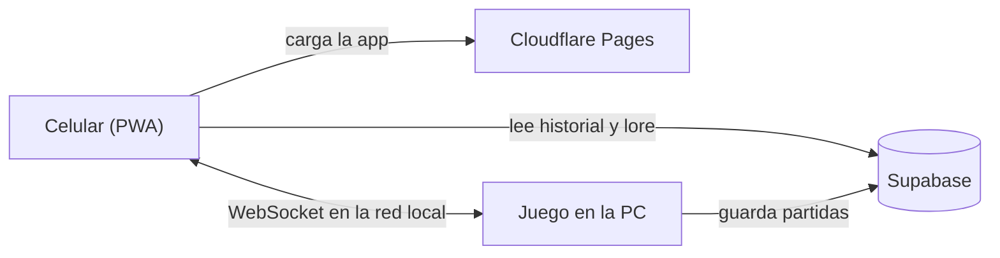
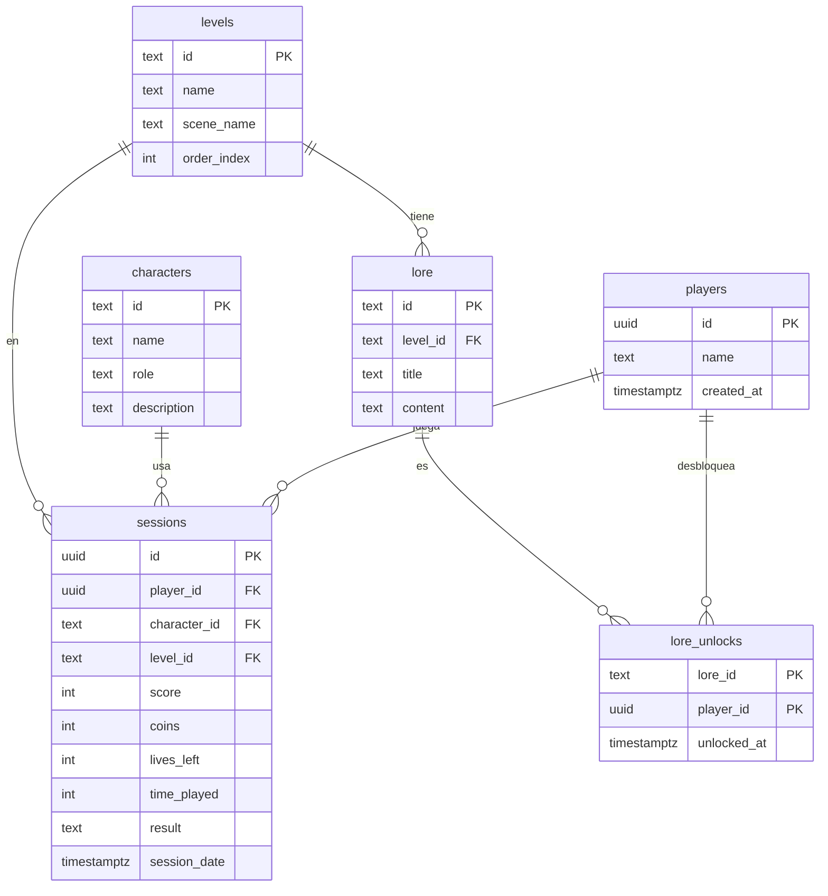
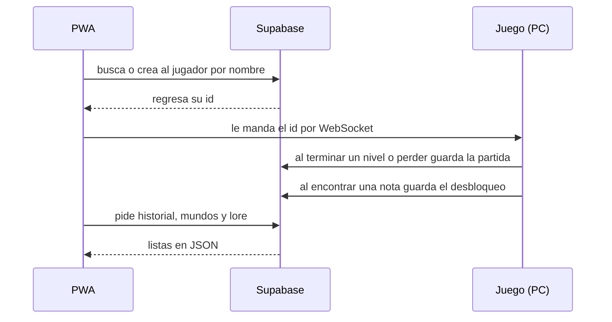
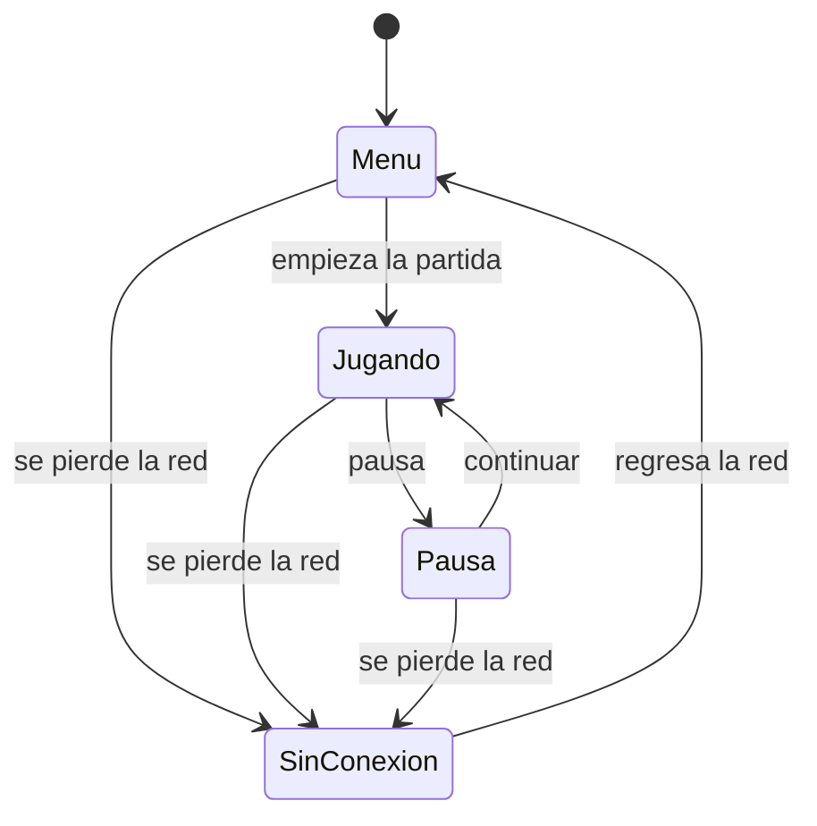
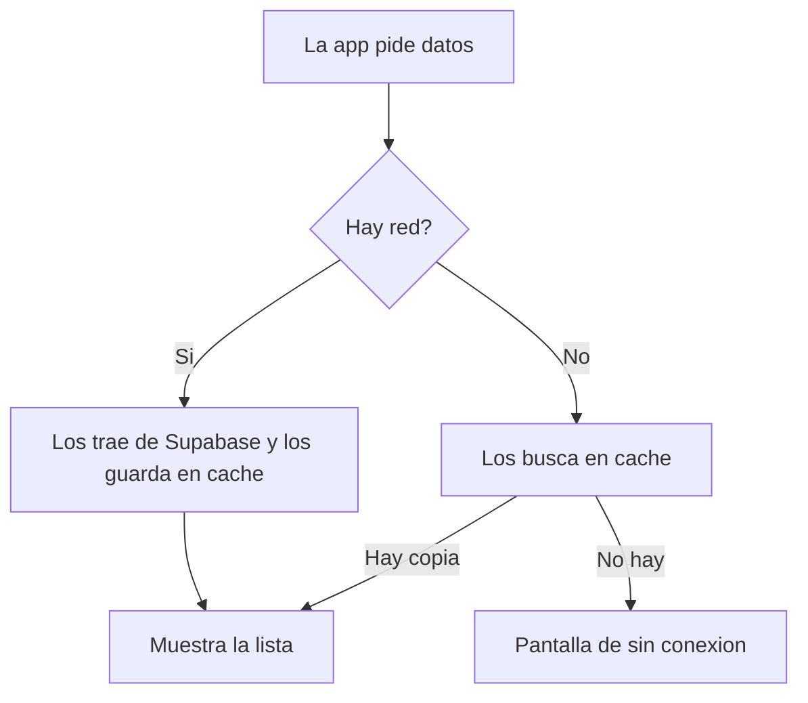
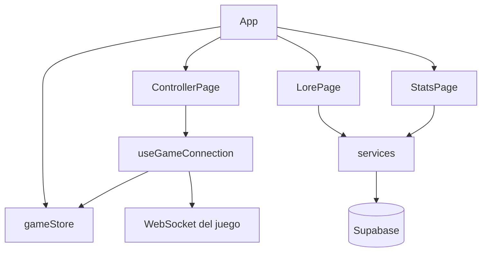

# Kimaya Companion (PWA)

Proyecto integrador. Es una app web progresiva que acompaña a nuestro juego **Kimaya: El Bosque del Eco** (plataformas 2D para PC).

La idea es que el celular sirva para dos cosas:

1. Como control del juego mientras se juega.
2. Para ver el lore del bosque y el historial de partidas cuando el juego esta en pausa o todavia no empieza.

El juego esta en otro repo: https://github.com/Thekiidd/proyecto-uni. Aqui solo va la PWA.

App publicada: https://kimaya-companion.pages.dev

## Que pide la actividad y como lo cubrimos

| Punto | Como lo resolvimos |
| --- | --- |
| Consumo de API | La app pide a Supabase las partidas, los mundos y el lore, y los pinta como listas |
| Estrategia PWA | Service worker con Workbox (vite-plugin-pwa) y manifest. Guarda en cache para que funcione sin internet |
| UI/UX | React + Tailwind, separado en paginas, hooks, store y servicios. Pensado para celular en horizontal |
| Documentacion | Este README con los diagramas |

## Como se conecta todo

Decidimos separarlo en dos partes:

- Lo que no es tiempo real (historial, lore, mundos) va a una base de datos en Supabase. Asi se puede ver aunque la compu este apagada.
- Los botones del control van por WebSocket directo a la PC, en la misma red wifi. Si los mandaramos por internet se sentiria con lag.



Para conectarse, el juego muestra un QR en la pantalla de la PC. El QR abre la app con la IP de la compu, por ejemplo:

```
https://<url-de-la-app>/?ip=192.168.1.20&port=8080
```

Si no se puede escanear, tambien se puede escribir la IP a mano.

Al entrar, el jugador pone su nombre. Con eso buscamos sus datos en la base (y si es nuevo lo damos de alta).

## Base de datos

Usamos Supabase porque ya trae una API REST lista y no tuvimos que hacer un backend.

Revisamos lo que el juego ya guarda en memoria en `GameData.cs` (personaje, nivel, puntaje, monedas y vidas) y armamos las tablas con base en eso. Los niveles son los mismos que tiene el juego: la aldea y 3 niveles.



Que guarda cada tabla:

- `players`: los jugadores. Se crea desde la app cuando alguien pone su nombre.
- `characters`: Falin y Mia. No cambia.
- `levels`: la aldea y los 3 niveles (`Village_Scene`, `Level_01`, `Level_02`, `Level_03`). No cambia.
- `sessions`: una fila cada vez que se termina un nivel o se pierde. La escribe el juego.
- `lore`: las notas del bosque que se pueden encontrar.
- `lore_unlocks`: que notas ya encontro cada jugador. La escribe el juego.

### SQL para crear las tablas

```sql
create table players (
  id uuid primary key default gen_random_uuid(),
  name text not null unique,
  created_at timestamptz not null default now()
);

create table characters (
  id text primary key,
  name text not null,
  role text not null,
  description text not null
);

create table levels (
  id text primary key,
  name text not null,
  scene_name text not null,
  order_index int not null,
  description text not null default ''
);

create table sessions (
  id uuid primary key default gen_random_uuid(),
  player_id uuid not null references players(id),
  character_id text not null references characters(id),
  level_id text not null references levels(id),
  score int not null default 0,
  coins int not null default 0,
  lives_left int not null default 0,
  time_played int not null default 0,
  result text not null check (result in ('nivel_completado', 'game_over')),
  session_date timestamptz not null default now()
);

create table lore (
  id text primary key,
  level_id text references levels(id),
  title text not null,
  content text not null
);

create table lore_unlocks (
  lore_id text not null references lore(id),
  player_id uuid not null references players(id),
  unlocked_at timestamptz not null default now(),
  primary key (lore_id, player_id)
);
```

Datos iniciales:

```sql
insert into characters (id, name, role, description) values
  ('falin', 'Falin', 'fisico', 'Empuja objetos y tiene salto impulsado.'),
  ('mia', 'Mia', 'tactico', 'Pasa por espacios chicos y encuentra secretos con el olfato.');

insert into levels (id, name, scene_name, order_index, description) values
  ('village', 'Aldea', 'Village_Scene', 0, 'Donde empieza todo.'),
  ('level_01', 'Nivel 1', 'Level_01', 1, 'Entrada al bosque.'),
  ('level_02', 'Nivel 2', 'Level_02', 2, 'El bosque se pone mas cerrado.'),
  ('level_03', 'Nivel 3', 'Level_03', 3, 'El ultimo tramo.');

insert into lore (id, level_id, title, content) values
  ('doc_01', 'level_01', 'El Despertar del Bosque', 'Mucho antes de que el mal corrompiera estas tierras, el eco del bosque guiaba a los perdidos.'),
  ('doc_02', 'level_02', 'Nota del Explorador Perdido', 'Si alguien encuentra esto, sigan el camino de las piedras amarillas.');
```

En el celular solo usamos la `anon key` de Supabase (la publica). La `service key` no va en la app.

### Quien lee y quien escribe



| Cuando | Quien | Que hace |
| --- | --- | --- |
| El jugador pone su nombre | App | Lo busca en `players`, si no existe lo crea |
| Se conecta el control | App | Le manda al juego `{ "event": "identify", "player_id": "..." }` |
| Termina un nivel | Juego | Guarda en `sessions` con `result = nivel_completado` |
| Se queda sin vidas | Juego | Guarda en `sessions` con `result = game_over` |
| Encuentra una nota | Juego | Guarda en `lore_unlocks` |
| Abre Historial / Lore / Mundos | App | Hace el GET y pinta la lista |

### Endpoints que usa la app

Todos van a `https://<proyecto>.supabase.co` con los headers `apikey` y `Authorization: Bearer <anon key>`.

```
# buscar jugador
GET  /rest/v1/players?name=eq.<nombre>&select=*

# crear jugador
POST /rest/v1/players            body: { "name": "Felipe" }

# historial (mas reciente primero)
GET  /rest/v1/sessions?player_id=eq.<id>&select=score,coins,lives_left,time_played,result,session_date,characters(name),levels(name)&order=session_date.desc

# mundos en orden
GET  /rest/v1/levels?select=id,name,description,order_index&order=order_index.asc

# lore desbloqueado
GET  /rest/v1/lore_unlocks?player_id=eq.<id>&select=unlocked_at,lore(id,title,content)
```

Lo que manda el juego al terminar un nivel:

```json
{
  "player_id": "id-que-mando-la-app",
  "character_id": "falin",
  "level_id": "level_01",
  "score": 4500,
  "coins": 12,
  "lives_left": 2,
  "time_played": 320,
  "result": "nivel_completado"
}
```

Mientras terminamos de crear el proyecto en Supabase, las pantallas leen `public/api/stats.json` y `public/api/lore.json` para poder probar.
## El control

El control va siempre en horizontal. Tiene cruceta, A, B, X, Y, Select y Start, y cambia segun el personaje:

- **Falin** (amarillo): botones extra de Empujar y Salto impulsado.
- **Mia** (rosa): botones extra de Olfato y Espacio estrecho.

Cuando el personaje recibe daño la pantalla parpadea en rojo, y tambien hay aviso cuando tiene poca vida o mata a un enemigo. Para la presentacion pusimos botones de prueba que simulan esos eventos sin tener el juego abierto.

Lore e Historial son menus desplegables que solo se pueden abrir cuando el juego esta en el menu o en pausa. Mientras se juega solo se ve el control.



### Mensajes por WebSocket

Se conecta a `ws://<ip-de-la-pc>:8080/mando`.

La app manda los botones asi (`s` es 1 cuando se presiona y 0 cuando se suelta):

```json
{ "b": "A", "s": 1 }
```

Botones: `UP`, `DOWN`, `LEFT`, `RIGHT`, `A`, `B`, `X`, `Y`, `SELECT`, `START`. Falin agrega `PUSH` y `BOOST`, Mia agrega `SMELL` y `SQUEEZE`.

El juego le avisa a la app:

```json
{ "event": "game_state", "state": "paused" }
{ "event": "character_switch", "character": "mia" }
{ "event": "damage_received" }
{ "event": "low_health", "health": 20 }
{ "event": "enemy_defeated" }
```

`state` puede ser `menu`, `playing` o `paused`.

## Offline y service worker

Usamos `vite-plugin-pwa`, que genera el service worker con Workbox y el manifest. La app se puede instalar en el celular y abre en pantalla completa.

Estrategias de cache:

- **CacheFirst** para JS, CSS, imagenes e iconos. Una vez descargados ya no los vuelve a pedir.
- **NetworkFirst** para la API. Intenta traer datos nuevos y si no hay red usa lo ultimo que guardo.



Si se va el internet no sale la pantalla de error del navegador. Sale una pantalla de "sin conexion" desde donde se puede seguir leyendo el lore y el historial guardados, y un boton para volver a conectarse con el QR o la IP.

## Estructura del proyecto

```
src/
  pages/       ControllerPage, LorePage, StatsPage
  hooks/       useGameConnection (WebSocket y lectura del QR)
  store/       gameStore (Zustand: personaje, vida, conexion)
  services/    llamadas a Supabase (en proceso)
public/
  api/         JSON de prueba
```



## Como correrlo

```bash
npm install
npm run dev
```

Para probar el service worker hay que hacer build:

```bash
npm run build
npm run preview
```

## Avance

Hecho:

- [x] Proyecto con Vite, React, Tailwind y vite-plugin-pwa
- [x] Control con cruceta y botones, con vibracion al presionar
- [x] Lectura de la IP desde el QR o escribiendola
- [x] Pantallas de lore e historial con datos de prueba
- [x] Colores segun el personaje y parpadeo al recibir daño
- [x] Diseño de la base de datos

Pendiente:

- [ ] Crear el proyecto en Supabase y conectar las pantallas
- [ ] Menus desplegables solo en pausa o menu
- [ ] Botones extra de Falin y Mia
- [ ] Pantalla de sin conexion
- [ ] Botones de prueba para daño, poca vida y enemigo derrotado
